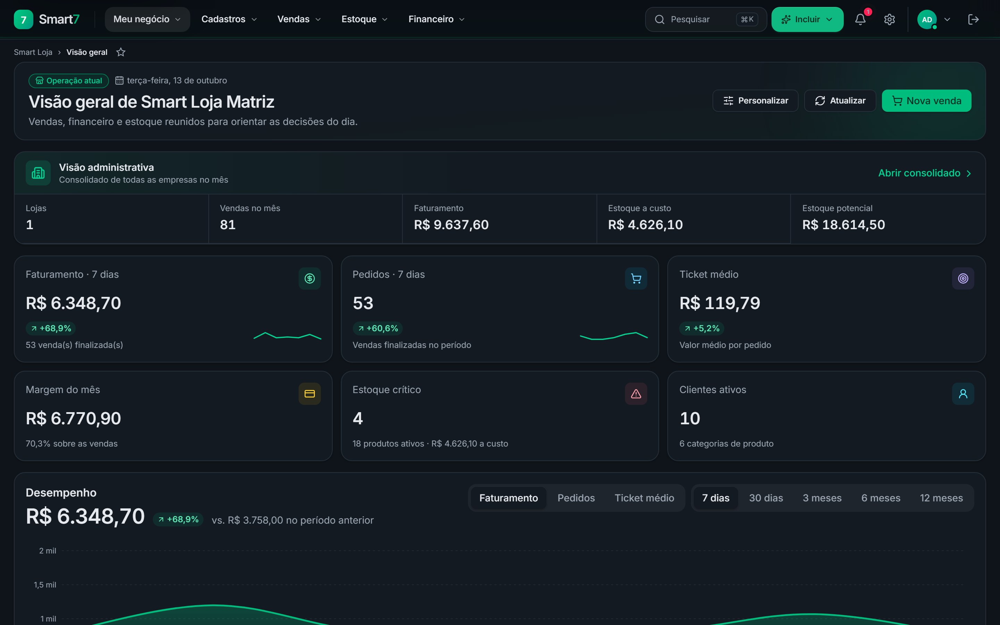

<!-- Perfil de 77sorryz. Imagens vivas (status e cobra) são geradas pela Action em .github/workflows/perfil.yml -->

<picture>
  <source media="(prefers-color-scheme: dark)" srcset="assets/banner-dark.svg">
  <source media="(prefers-color-scheme: light)" srcset="assets/banner-light.svg">
  
</picture>

  

  
  

 

**Keven, o sorry**, constrói sistemas, interfaces e ferramentas com IA que encurtam o dia a dia.
Do banco de dados ao app instalável, com o mesmo cuidado no código e no que aparece na tela.

 

### `01` · Agora

<a href="https://discord.com/users/810005107801718804">
  <picture>
    <source media="(prefers-color-scheme: dark)" srcset="https://raw.githubusercontent.com/77sorryz/77sorryz/output/status-dark.svg">
    <source media="(prefers-color-scheme: light)" srcset="https://raw.githubusercontent.com/77sorryz/77sorryz/output/status-light.svg">
    
  </picture>
</a>

Lido do Discord a cada 30 minutos por uma GitHub Action deste repositório.

  

### `02` · Projeto em destaque

<table>
  <tr>
    <td width="44%" valign="top">
      <h3>Smart7</h3>
      
ERP multiloja para varejo: frente de caixa, nota fiscal, estoque, financeiro e relatórios, com os dados de cada loja isolados.

      

        ▸ PDV com leitor de código de barras e impressão térmica 
        ▸ NF-e e NFC-e com contingência quando a SEFAZ cai 
        ▸ Estoque transacional, tudo ou nada 
        ▸ 82 permissões e 5 perfis por loja 
        ▸ 30 relatórios, com envio agendado por e-mail
      

      

      Código privado · telas reais com dados de demonstração
    </td>
    <td width="56%">
      <picture>
        <source media="(prefers-color-scheme: dark)" srcset="assets/smart7-dark.jpg">
        <source media="(prefers-color-scheme: light)" srcset="assets/smart7-light.jpg">
        
      </picture>
    </td>
  </tr>
</table>

 

### `03` · Ferramentas

Com **Claude** como parceiro de código, do plano ao teste.

 

### `04` · Fora do editor

| Em rotação | Na tela | No fone |
|:--|:--|:--|
| Valorant | Christopher Nolan, todos | Yunkvino |
| Minecraft | Marvel e DC, todos | Veigh |
| FiveM | Jumper | Niink |
| Forza Horizon 4 · 5 · 6 | Suits | G.A |
| Elden Ring | MobLand | LH Chucro |
| Cyberpunk 2077 | As séries novas da HBO | AK Lipe |
| Aion 2 · New World | Ficção científica e viagens espaciais | Ghard |

 

### `05` · Contribuições

<picture>
  <source media="(prefers-color-scheme: dark)" srcset="https://raw.githubusercontent.com/77sorryz/77sorryz/output/snake-dark.svg">
  <source media="(prefers-color-scheme: light)" srcset="https://raw.githubusercontent.com/77sorryz/77sorryz/output/snake.svg">
  
</picture>

sorry<b>.</b> · feito em código, quadro a quadro

